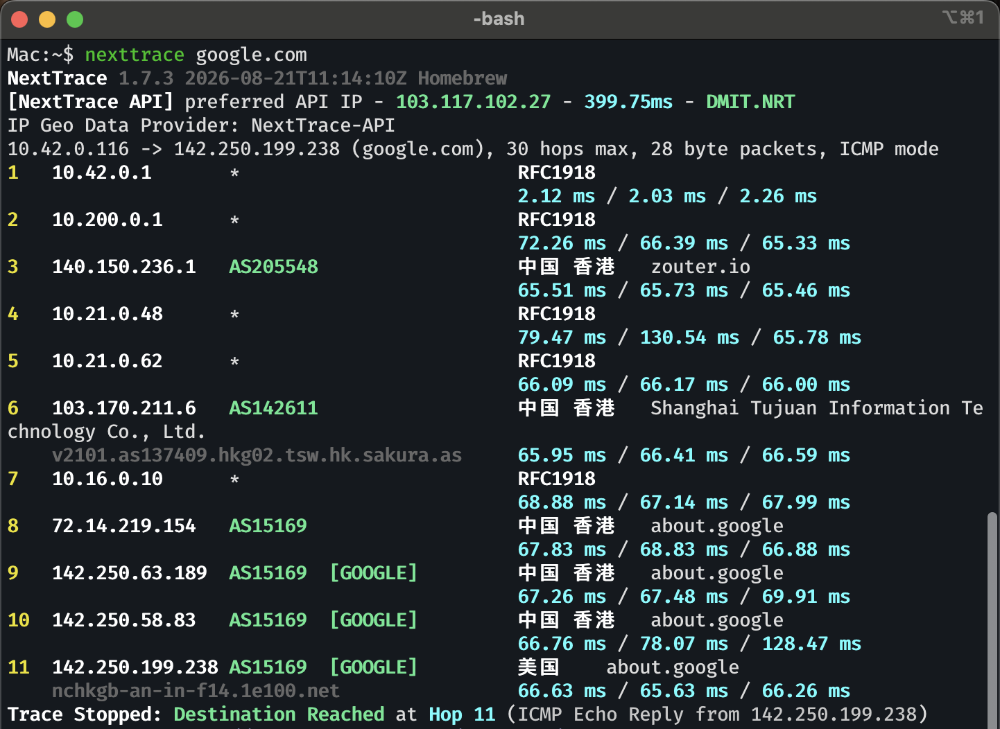

# Migrate to Layer 3 traffic routing

近来突然不想用应用层代理（Mihomo）了；恰逢要做计网的实验，不能一直开着这样的代理，那我便换一个方案。

<!-- more -->

由于我的代理节点全部是自建的，我可以随便选择协议；所以便有了这个方案：

我们可以先用组网工具（比如我这里用的 Easytier）建立连接，然后在这个网络里面跑 GRE 隧道，这样我们就先在我们的电脑和海外的机器之间建立了一条可以被视为网络层的通道了，可以直接通过这个隧道来传输经过组网工具加密后的裸数据包；接着，我们可以使用 nftables 针对 IP 进行内核级的分流，同样直接传输原始的数据包，这样就差不多做完了。

最后的结果差不多是这样的，我们可以让所有连接电脑热点的设备（现在这个电脑可以被称为软路由了）顺利进行 traceroute 等操作，就像这样



## 配置 Easytier 组网

这里就不多说了；由于我们后续在用 nftables 进行分流的时候需要绕开 Easytier 的流量，所以我们需要在配置最后加一个小的 flag

```toml
[flag]
socket_mark = 131072
```

也就是 `0x20000`；这样我们就可以很方便的排除掉不应该分流的流量。

最后，我将以这样的网络进行后续的操作（已省略无关内容）

/// details | Easytier Peer
    type: plain
```bash
$ easytier-cli peer
| ipv4              | hostname        | cost     | lat(ms) | loss |
|-------------------|-----------------|----------|---------|------|
| 100.100.100.2/24  | archlinux       | Local    | -       | -    |
| 100.100.100.11/24 | zouter-hk       | p2p      | 63.09   | 0.0% |
```
///

## 建立 GRE L3 隧道

我们大概的配置是这样的

| | Easytier | GRE | GRE Interface |
| --- | --- | --- | --- |
| **Router** | 100.100.100.2 | 10.200.0.2/30 | gre-hk |
| **HK VPS** | 100.100.100.11 | 10.200.0.1/30 | gre-router |

先加载 GRE 内核模块

```bash
sudo modprobe ip_gre
echo "ip_gre" | sudo tee -a /etc/modules-load.d/gre.conf
```

然后我们先在本机做好配置

### 本机侧（Router）

/// details | `/etc/l3-router/router.conf`
    type: plain
```ini
ET_LOCAL=100.100.100.2
ET_REMOTE=100.100.100.11

GRE_LOCAL=10.200.0.2
GRE_PEER=10.200.0.1
GRE_PREFIX=30
GRE_MTU=1280

ROUTE_TABLE=100

ROUTE_MARK=0x10000
ROUTE_MARK_MASK=0x10000

DIRECT_MARK=0x20000
DIRECT_MARK_MASK=0x20000
```
///

然后开启 IPv4 Forwarding

/// details | `/etc/sysctl.d/80-l3-router.conf`
    type: plain
```ini
net.ipv4.ip_forward = 1
net.ipv4.conf.all.rp_filter = 2
net.ipv4.conf.default.rp_filter = 2
```
///

```bash
sudo sysctl --system
```

然后创建一个 bash 脚本来管理网络接口

/// details | `/usr/local/sbin/l3-router-gre`
    type: plain
```bash
#!/bin/sh
set -eu

. /etc/l3-router/router.conf

# 等待 Easytier Peer 可达
until ip -4 route get "$DIRECT_REMOTE" 2>/dev/null | grep -q "src $DIRECT_LOCAL"; do
    sleep 1
done

ip link show gre-hk >/dev/null 2>&1 && ip tunnel del gre-hk

ip tunnel add gre-hk \
    mode gre \
    local "$DIRECT_LOCAL" \
    remote "$DIRECT_REMOTE" \
    ttl 64

ip addr replace "$GRE_LOCAL/$GRE_PREFIX" dev gre-hk
ip link set gre-hk mtu "$GRE_MTU"
ip link set gre-hk up

ip route replace default dev gre-hk table "$ROUTE_TABLE"

ip rule del \
    priority 9000 \
    fwmark "$DIRECT_MARK/$DIRECT_MARK_MASK" \
    table main 2>/dev/null || true

ip rule del \
    priority 10000 \
    fwmark "$ROUTE_MARK/$ROUTE_MARK_MASK" \
    table "$ROUTE_TABLE" 2>/dev/null || true

ip rule add \
    priority 9000 \
    fwmark "$DIRECT_MARK/$DIRECT_MARK_MASK" \
    table main

ip rule add \
    priority 10000 \
    fwmark "$ROUTE_MARK/$ROUTE_MARK_MASK" \
    table "$ROUTE_TABLE"
```
///

```bash
sudo chmod +x /usr/local/sbin/l3-router-gre
```

再使用 `systemd` 来管理这个脚本

/// details | `/etc/systemd/system/l3-router-gre.service`
    type: plain
```ini
[Unit]
Description=L3 GRE tunnel over EasyTier
After=network-online.target
Wants=network-online.target

[Service]
Type=oneshot
ExecStart=/usr/local/sbin/l3-router-gre
RemainAfterExit=yes
TimeoutStartSec=0

[Install]
WantedBy=multi-user.target
```
///

```bash
sudo systemctl daemon-reload
sudo systemctl enable --now l3-router-gre
```

### 海外侧（HK VPS）

接下来在我们的 VPS 上配置好出口

/// details | `/etc/l3-vps.conf`
    type: plain
```ini
ET_LOCAL=100.100.100.11
ET_REMOTE=100.100.100.2

GRE_LOCAL=10.200.0.1
GRE_PREFIX=30
GRE_MTU=1280
```
///

同样配置 IPv4 Forwarding

/// details | `/etc/sysctl.d/80-l3-vps.conf`
    type: plain
```ini
net.ipv4.ip_forward = 1
net.ipv4.conf.all.rp_filter = 2
net.ipv4.conf.default.rp_filter = 2
```
///

```bash
sudo sysctl --system
```

然后配有关脚本

/// details | `/usr/local/sbin/l3-vps-gre`
    type: plain
```bash
#!/bin/sh
set -eu

. /etc/l3-vps.conf

# 等待 Easytier Peer 可达
until ip -4 route get "$ET_REMOTE" 2>/dev/null | grep -q "src $ET_LOCAL"; do
    sleep 1
done

ip link show gre-router >/dev/null 2>&1 &&
    ip tunnel del gre-router

ip tunnel add gre-router \
    mode gre \
    local "$ET_LOCAL" \
    remote "$ET_REMOTE" \
    ttl 64

ip addr replace "$GRE_LOCAL/$GRE_PREFIX" dev gre-router
ip link set gre-router mtu "$GRE_MTU"
ip link set gre-router up
```
///

```bash
sudo chmod +x /usr/local/sbin/l3-vps-gre
```

以及相关 `systemd` 配置

/// details | `/etc/systemd/system/l3-vps-gre.service`
    type: plain
```ini
[Unit]
Description=L3 GRE endpoint over EasyTier
After=network-online.target
Wants=network-online.target

[Service]
Type=oneshot
ExecStart=/usr/local/sbin/l3-vps-gre
RemainAfterExit=yes
TimeoutStartSec=0

[Install]
WantedBy=multi-user.target
```
///

```bash
sudo systemctl daemon-reload
sudo systemctl enable --now l3-vps-gre
```

那么我们的第一步就做好了。现在可以用 `ip a` 在两边看到这个网络接口，你也可以 `ping` 一下看看能否连上。

接下来我们开始配 nftables

## 配置海外侧 nftables

首先在海外的 VPS 上配置好，让我们可以传输代理流量

/// details | `/etc/l3-vps.nft`
    type: plain
```nginx
# TCP MSS Clamp，不加容易出现 MTU 相关问题
table inet l3vps_mss {
    chain forward {
        type filter hook forward priority mangle
        policy accept

        iifname "gre-router" \
            tcp flags syn \
            tcp option maxseg size set 1240

        oifname "gre-router" \
            tcp flags syn \
            tcp option maxseg size set 1240
    }
}

table ip l3vps_nat {
    chain postrouting {
        type nat hook postrouting priority srcnat
        policy accept

        ip saddr 10.200.0.2 \
            oifname "eth0" \
            masquerade
    }
}
```
///

然后是加载脚本和对应的 `systemd`

/// details | `/usr/local/sbin/l3-vps-nft-load`
    type: plain
```bash
#!/bin/sh
set -eu

nft list table ip l3vps_mss >/dev/null 2>&1 &&
    nft delete table ip l3vps_mss || true

nft list table ip l3vps_nat >/dev/null 2>&1 &&
    nft delete table ip l3vps_nat || true

nft -f /etc/l3-vps.nft
```
///

/// details | `/etc/systemd/system/l3-vps-nft.service`
    type: plain
```ini
[Unit]
Description=L3 VPS NAT
After=l3-vps-gre.service nftables.service
Requires=l3-vps-gre.service

[Service]
Type=oneshot
ExecStart=/usr/local/sbin/l3-vps-nft-load
ExecReload=/usr/local/sbin/l3-vps-nft-load
RemainAfterExit=yes

[Install]
WantedBy=multi-user.target
```
///

然后启动他们

```bash
sudo systemctl daemon-reload
sudo chmod +x /usr/local/sbin/l3-vps-nft-load
sudo systemctl enable --now /etc/systemd/system/l3-vps-nft
```

接下来可以在本机测试一下

```bash
$ ping 1.1.1.1 -I gre-hk -c 5
PING 1.1.1.1 (1.1.1.1) from 10.200.0.2 gre-hk: 56(84) bytes of data.
64 bytes from 1.1.1.1: icmp_seq=1 ttl=53 time=63.9 ms
64 bytes from 1.1.1.1: icmp_seq=2 ttl=53 time=63.9 ms
64 bytes from 1.1.1.1: icmp_seq=3 ttl=53 time=64.0 ms
64 bytes from 1.1.1.1: icmp_seq=4 ttl=53 time=64.6 ms
64 bytes from 1.1.1.1: icmp_seq=5 ttl=53 time=64.0 ms

--- 1.1.1.1 ping statistics ---
5 packets transmitted, 5 received, 0% packet loss, time 4002ms
rtt min/avg/max/mdev = 63.859/64.074/64.615/0.275 ms
```

这样就是没问题了。接下来在本机进行分流

## 配置本机 nftables

这里我们先不管 IPv6，只按 IPv4 来进行分流。

/// details | `/etc/l3-router/router.nft`
    type: plain
```nginx
table inet l3route {
    # 来自内网的地址
    set lan_src4 {
        type ipv4_addr
        flags interval
        auto-merge

        elements = {
            10.0.0.0/8,
            100.64.0.0/10,
            172.16.0.0/12,
            192.168.0.0/16
        }
    }

    # 不应进入 GRE 的内网地址
    set private4 {
        type ipv4_addr
        flags interval
        auto-merge

        elements = {
            0.0.0.0/8,
            10.0.0.0/8,
            100.64.0.0/10,
            127.0.0.0/8,
            169.254.0.0/16,
            172.16.0.0/12,
            192.0.0.0/24,
            192.168.0.0/16,
            198.18.0.0/15,
            224.0.0.0/4,
            240.0.0.0/4,
            100.100.100.0/24
        }
    }

    # 中国 IP
    set cn4 {
        type ipv4_addr
        flags interval
        auto-merge
    }

    chain classify {
        ip daddr @private4 return # 私有/特殊地址直连

        ip daddr @cn4 return # 中国大陆公网 IP 直连

        meta mark set meta mark | 0x10000 # 其他 IPv4 走国外 GRE
    }

    chain prerouting {
        type filter hook prerouting priority mangle
        policy accept

        ip saddr @lan_src4 jump classify
    }

    chain output {
        type route hook output priority mangle
        policy accept

        meta mark & 0x20000 != 0 return # 不应被送进 GRE 的，如 Easytier

        jump classify
    }
}

table ip l3route_nat {
    chain postrouting {
        type nat hook postrouting priority srcnat
        policy accept

        oifname "gre-hk" masquerade
    }
}
```
///

接下来，我们处理中国 IPv4 的分流。随便找个地方下载，比如[这里](https://github.com/fernvenue/chn-cidr-list/blob/master/ip.txt)，然后用脚本转成 nftables 的格式，比如

```bash
#!/bin/sh
set -eu

SRC=/etc/l3-router/cn4.cidr
OUT=/etc/l3-router/cn4.nft
TMP="${OUT}.tmp"

{
    echo 'add element inet l3route cn4 {'
    grep -F '.' "$SRC" | sed 's/$/,/'
    echo '}'
} > "$TMP"

mv "$TMP" "$OUT"
```

（这里你可能需要替换一下 `SRC` 变量）

然后我们新建加载 nftables 的脚本和对应的服务

/// details | `/usr/local/sbin/l3-router-nft-load`
    type: plain
```bash
#!/bin/sh
set -eu

nft list table inet l3route >/dev/null 2>&1 &&
    nft delete table inet l3route || true

nft list table ip l3route_nat >/dev/null 2>&1 &&
    nft delete table ip l3route_nat || true

nft -f /etc/l3-router/router.nft

if [ -s /etc/l3-router/cn4.nft ]; then
    nft -f /etc/l3-router/cn4.nft
fi
```
///

/// details | `/etc/systemd/system/l3-router-nft.service`
    type: plain
```ini
[Unit]
Description=L3 router nftables rules
After=l3-router-gre.service nftables.service
Requires=l3-router-gre.service

[Service]
Type=oneshot
ExecStart=/usr/local/sbin/l3-router-nft-load
ExecReload=/usr/local/sbin/l3-router-nft-load
RemainAfterExit=yes

[Install]
WantedBy=multi-user.target
```
///

```bash
sudo systemctl daemon-reload
sudo systemctl enable --now l3-router-nft
```

这样就完成啦。我们可以尝试一下他是不是会自动的分流，试一下 traceroute

```bash
$ nexttrace 1.1.1.1
NextTrace v1.7.3 2026-08-23T16:13:15Z 40ac803
[NextTrace API] preferred API IP - 103.117.102.27 - 382.32ms - DMIT.NRT
IP Geo Data Provider: NextTrace-API
172.26.104.55 -> 1.1.1.1, 30 hops max, 28 byte packets, ICMP mode
1   10.200.0.1      *                         RFC1918
                                              71.71 ms / 63.12 ms / 62.89 ms
2   140.150.236.1   AS205548                  中国 香港   zouter.io
                                              63.89 ms / 63.66 ms / 63.47 ms
3   10.21.0.48      *                         RFC1918
                                              64.06 ms / 63.38 ms / 64.09 ms
4   10.21.0.62      *                         RFC1918
                                              64.19 ms / 63.42 ms / 71.51 ms
5   36.255.57.178   *                         中国 香港
    49304.hkg.equinix.com                     63.72 ms / 63.58 ms / 63.62 ms
6   36.255.57.108   AS13335                   中国 香港  Equinix Hong Kong - Cloudflare - 300Gbps cloudflare.com
    13335-hk2-ix.equinix.com                  63.90 ms / 64.07 ms / 64.12 ms
7   103.22.203.1    AS13335  [CLOUDFLARE-AP]  中国 香港   cloudflare.com
                                              71.14 ms / * ms / * ms
8   103.22.203.79   AS13335  [CLOUDFLARE-AP]  中国 香港   cloudflare.com
                                              65.25 ms / * ms / * ms
9   1.1.1.1         AS13335                   Anycast    cloudflare.com
    one.one.one.one                           64.49 ms / 63.81 ms / 64.06 ms
Trace Stopped: Destination Reached at Hop 9 (ICMP Echo Reply from 1.1.1.1)
```

可以看到这里成功的自动走我们的 VPS 了，这样就做完了

吗？

## 配置 DNS

很容易我们发现出现 DNS 污染了，如果我想同时保证校内的解析的话。这里我们直接用 MosDNS 进行分流

/// details | `/etc/mosdns/config.yaml`
    type: plain
```yaml
log:
  level: info

plugins:
  - tag: geosite_cn
    type: domain_set
    args:
      files:
        - /etc/mosdns/rules/geosite_cn.txt

  - tag: forward_nju
    type: forward
    args:
      concurrent: 2
      upstreams:
        - tag: nju1
          addr: 10.28.253.4
        - tag: nju2
          addr: 10.12.253.4

  - tag: forward_cn
    type: forward
    args:
      concurrent: 2
      upstreams:
        - tag: dnspod
          addr: https://doh.pub/dns-query
          dial_addr: 1.12.12.12

        - tag: alidns
          addr: https://dns.alidns.com/dns-query
          dial_addr: 223.5.5.5

  - tag: forward_foreign
    type: forward
    args:
      concurrent: 2
      upstreams:
        - tag: cloudflare
          addr: https://cloudflare-dns.com/dns-query
          dial_addr: 1.1.1.1

        - tag: google
          addr: https://dns.google/dns-query
          dial_addr: 8.8.8.8

  - tag: seq_nju
    type: sequence
    args:
      - exec: $forward_nju

  - tag: seq_cn
    type: sequence
    args:
      - exec: $forward_cn

  - tag: seq_foreign
    type: sequence
    args:
      - exec: $forward_foreign

  - tag: main
    type: sequence
    args:
      - matches:
          - qtype 28
        exec: reject 0

      - exec: cache 8192

      - matches:
          - has_resp
        exec: accept

      - matches:
          - qname nju.edu.cn
        exec: goto seq_nju

      - matches:
          - qname $geosite_cn
        exec: goto seq_cn

      - exec: goto seq_foreign

  - tag: udp_server
    type: udp_server
    args:
      entry: main
      listen: 127.0.0.1:53

  - tag: tcp_server
    type: tcp_server
    args:
      entry: main
      listen: 127.0.0.1:53
```
///

其中，`/etc/mosdns/rules/geosite_cn.txt` 可以用 `v2dat` 转换一下得到。

启动 MosDNS，然后我们配置本机和热点的 DNS 使用这个 DNS

/// details | `/etc/NetworkManager/dnsmasq-shared.d/mosdns.conf`
    type: plain
    open: true
```ini
no-resolv
server=127.0.0.1#53
```
///

这样就可以正常使用啦。

## 最后

如果你还想继续分流的话，可以用相同的方法连接下一台 VPS，然后在 nftables 和 MosDNS 里面配好。或者，你也可以集成一个 Mihomo 进去，参考我的配置

改 MosDNS 的配置，国外部分统一使用 Mihomo 提供的 DNS

```yaml
  - tag: forward_foreign
    type: forward
    args:
      upstreams:
        - tag: mihomo
          addr: 127.0.0.1:1053
```

然后你可以参考我的 Mihomo 配置

```yaml
dns:
  enable: true
  listen: 127.0.0.1:1053
  ipv6: false
  enhanced-mode: fake-ip
  fake-ip-range: 198.18.0.1/16
  # 只对需要重新分流的域名使用 fake-ip
  fake-ip-filter-mode: rule
  fake-ip-filter:
    - RULE-SET,claude,fake-ip
    - GEOSITE,anthropic,fake-ip
    - GEOSITE,category-ntp,fake-ip
    - GEOSITE,youtube,fake-ip # 单独分流 Youtube
    - GEOSITE,category-ai-!cn,fake-ip
    - GEOSITE,google,fake-ip
    - MATCH,real-ip
  # DNS 全部走 gre-hk 出口，防止 DNS 污染
  nameserver:
    - https://1.1.1.1/dns-query#gre-hk
    - https://8.8.8.8/dns-query#gre-hk
  proxy-server-nameserver:
    - https://1.1.1.1/dns-query#gre-hk
    - https://8.8.8.8/dns-query#gre-hk
tun:
  enable: true
  stack: mixed
  auto-route: true
  auto-redirect: false
  auto-detect-interface: false
  gso: true
  gso-max-size: 65536
  # 不劫持 DNS
  dns-hijack: []
  iproute2-table-index: 2022
  iproute2-rule-index: 9500
  route-address:
    - 198.18.0.0/16
    - 160.79.104.0/21 # Claude 分流
proxy-providers:
  sprite:
    type: http
    url: https://example.com/
    override:
      interface-name: eno1 # 填你的主要上网网卡
      routing-mark: 131072 # 和 Easytier 一样不走 GRE
      ip-version: ipv4
```

这样就可以大部分流量都直连，小部分走 Mihomo 的 fake-ip 进行分流了。
